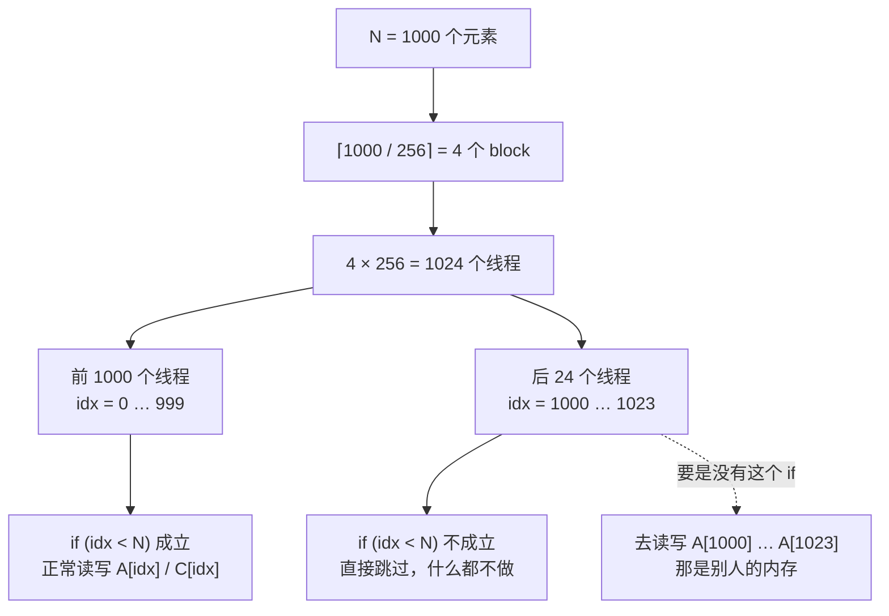
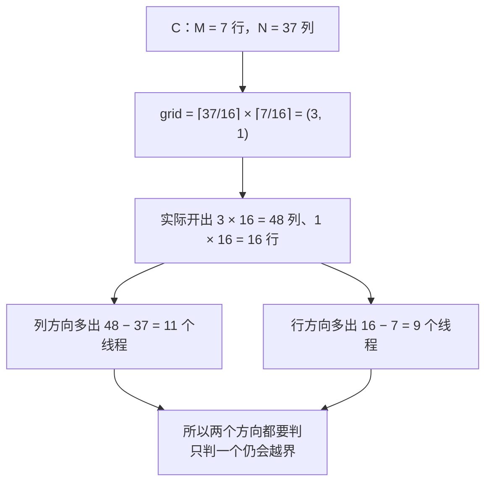
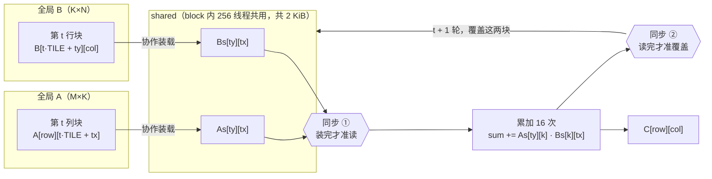
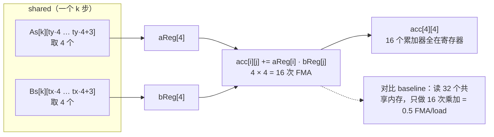
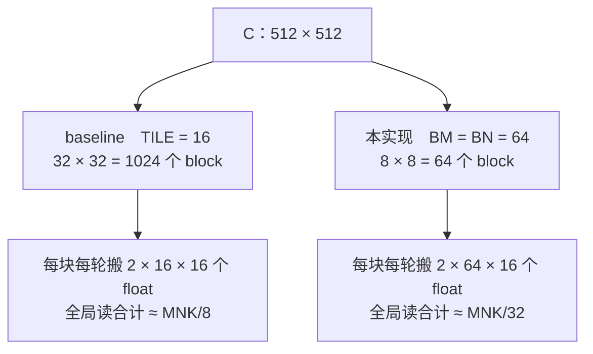
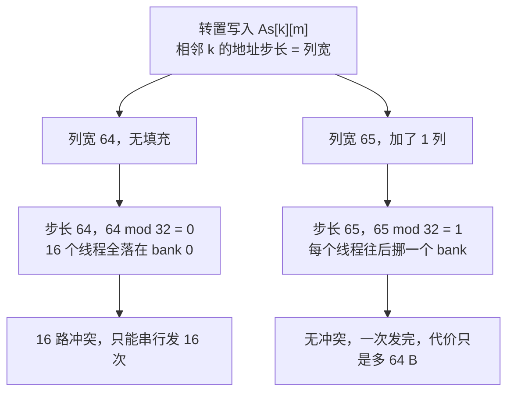
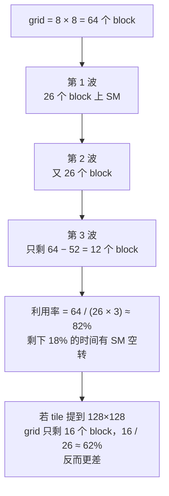

# 技术报告

==🔴注：基础阶段部分题目未保留到源代码，因此报告中指令与原来的指令可能会有出入；且进阶部分因容器原因，所以代码测试我是借助ai利用本地虚拟机测试的，相关环境我会放在后文，我为此可能对您造成的不便深感抱歉。另外，报告中所提到的交付物均在GitHub仓库中。==

---

## 1. 概要

### 1.1 任务范围

| 阶段 | 内容 | 交付物 |
| --- | --- | --- |
| 基础 | 共 13 关，即 Linux 和 Git 部分 | 详见仓库 |
| 进阶 | CUDA 方向基础四关 + 6-1 GEMM 优化 | 详见仓库 |

### 1.2 环境与工具链

| 项目 | 值 |
| --- | --- |
| 考核平台 | 容器网页终端 |
| 本地辅助环境 | VMware® Workstation 17 Pro + ubuntu-24.04.3-live-server-amd64.iso（默认设置） |
| GPU | 本机 NVIDIA GeForce RTX 5060 Laptop GPU（Blackwell，`sm_120`，8 GB GDDR7，**26 个 SM**，FP32 峰值约 9.7 TFLOPS）；虚拟机无法直通该独显，故 GPU 侧仅用于编译验证 |
| 驱动 | 591.91（Windows 宿主侧；虚拟机内无 GPU 直通，该驱动仅用于说明本机硬件配置） |
| CUDA Toolkit | 12.0（虚拟机内 Ubuntu 24.04 的 `nvidia-cuda-toolkit`）；注：本机显卡需 12.8+ 才能直编 `sm_120`，因此虚拟机里统一用 `-arch=sm_75` 做语法与符号验证 |
| 语言/工具 | Bash、C（gcc）、C++/CUDA（nvcc）、Python（验证脚本） |

### 1.3 一页结论

- 最终关选用 **6-1 GEMM 优化**方向，交付文件 `gemm_opt.cu`，另附 `report.md`（本文件）。
- 核心优化手段：**64×64 block tile + 每线程 4×4 寄存器分块 + A 转置进 shared（并加 1 列填充）**，
  把计算访存比从 baseline 的 **0.5 FMA/shared-load 提到 2.0**（4 倍），
  全局访存量降到 baseline 的 **1/4**。
- 正确性：用 Python **逐字复刻** kernel 语义（装载/同步/填 0/写回判边界/累加顺序）后与朴素三重循环对拍，
  **80 组尺寸全部通过且逐位相同**；编译与符号链接已在本地虚拟机通过。
  性能以平台返回的 `performanceMedianUs` 为准（本机虚拟机无 GPU 直通，未做端到端实测）。

---

## 2. 基础阶段：Linux

### 2.1 第 1 关：找到入口

1、通过网页界面，找到密钥文本和input.bin
2、使用-help查看exam使用方法
3、使用cp将input.bin复制到input
4、用-e将密钥传入驱动程序，生成output
5、用cp将output复制到`/workspace/flag`，提交

### 2.2 第 2 关：两段信号

1、通过网页界面，找到signal-A.bin、signal-B.bin和word.txt
2、使用grep找到密钥
3、同第一关处理signal-A.bin、signal-B.bin
4、将输出用cp保留成outputA和outputB
5、用cat指令将outputA、outputB输出为/workspace/flag，提交

### 2.3 第 3 关：读日志并修复输入

1、通过网页界面，找到密钥文本和input.txt
2、同第一关处理input.txt
3、使用-e将密钥传入驱动程序后发现失败
4、使用cat查看日志，发现缺少一个字节
5、使用sed在input文件结尾换行符前加入“ ”
6、使用-e将密钥传入驱动程序，生成output
7、用cp将output复制到`/workspace/flag`，提交

==🔴注：4-7关因个人能力原因使用ai通关，故如不想看可直接跳过==

### 2.4 第 4 关：让命令找到路

1、**先侦察接口**，翻帮助确认参数、输出格式、退出码

```bash
"$TASK_TOOL_DIR/task-probe" --help
"$TASK_TOOL_DIR/task-probe" ok TEST-1; echo "rc=$?"
```

2、**幂等前置 `PATH`**，用冒号补齐做目录级比较

```bash
case ":$PATH:" in
    *":$TASK_TOOL_DIR:"*) ;;
    *) PATH="$TASK_TOOL_DIR:$PATH" ;;
esac
export PATH
```

3、**读配置但不清空环境注入的变量**

```bash
TASK_TOOL_DIR=${TASK_TOOL_DIR:-}
ROUTE_RESULT=${ROUTE_RESULT:-}
[ -r "$CONF" ] && . "$CONF"
export ACCESS_TOKEN
```

4、**参数校验放在写文件之前**，用 glob 一次判字符集

```bash
case "$ITEM" in
    ''|*[!A-Za-z0-9]*) usage; exit 64 ;;
esac
[ "${#ITEM}" -le 32 ] || { usage; exit 64; }
```

5、**调工具、紧跟取 `rc`、做三级映射**

```bash
out=$(task-probe "$MODE" "$ITEM"); rc=$?
case "$MODE:$rc" in
    ok:0)     printf '%s\n' "$out"  > "$ROUTE_RESULT"; exit 0 ;;
    retry:11) printf 'retry:%s\n'    "$ITEM" > "$ROUTE_RESULT"; exit 75 ;;
    fatal:23) printf 'rejected:%s\n' "$ITEM" > "$ROUTE_RESULT"; exit 65 ;;
    *)        printf 'rejected:%s\n' "$ITEM" > "$ROUTE_RESULT"; exit 65 ;;
esac
```

6、**结果文件满足三个字节要求**：覆盖写、恰一行、结尾一个换行——`printf '%s\n'` 一条命令同时满足。

### 2.5 第 5 关：照看后台任务

1、**判活写成五重校验**，不只看 PID 存在

```bash
is_worker_pid() {
    case "${p:-}" in ''|*[!0-9]*) return 1 ;;     # 纯数字
    [ "$p" -gt 1 ] || return 1 ;;                  # 排除 0/1
    kill -0 "$p" 2>/dev/null || return 1 ;;        # 存在且有权限
    [ "$(pid_state "$p")" = Z ] && return 1 ;;     # 僵尸视为已退出
    case "$(tr '\0' ' ' <"/proc/$p/cmdline")" in   # 防 PID 复用
        *"$WORKER"*) return 0 ;; *) return 1 ;;
    esac
}
```

2、**启动用"新会话 + 关 fd + exec"三件套**，保证不持有终端/管道，且 `$!` 就是 worker 的真实 PID

```bash
python3 -c '
import os, sys, errno
try: os.setsid()
except OSError as e:
    if e.errno != errno.EPERM: raise
try: os.closerange(3, 4096)
except Exception: pass
os.execv(sys.argv[1], sys.argv[1:])
' "$WORKER" >>"$OUTLOG" 2>&1 </dev/null &
printf '%s\n' "$!" >"$PIDFILE"
```

降级链：`python3` → `setsid` → `nohup`，逐级兜底。

3、**单实例**：启动前先 `is_worker_pid`，活着就直接返回 0（复用），不重复起。
4、**`start` 有界等待**，确认进程真的起来就返回，不无限等

```bash
i=0; while [ "$i" -lt 12 ]; do is_worker_pid "$pid" && break; sleep 0.05; i=$((i+1)); done
```

5、**`stop` 先礼后兵**：`TERM` → 3 秒有界等待 → 仍在则 `KILL`；结束后**再等日志写完**才做检查。
6、**`report` 用可解析的输出**

```bash
COLUMNS=200 LC_ALL=C timeout 5 top -b -n 1 -c -p "$pid"
ps -ww -o pid,ppid,pgid,sid,stat,etime,time,user,args -p "$pid"
{ printf 'PID=%s\n' "$pid"; ps ...; top ...; } > "$out" 2>&1
```

7、**未知子命令**：打印 usage，`exit 64`；缺 PID 文件时统一报 not-running，不抛栈。

### 2.6 第 6 关：交给服务账号

1、**先探现场，再决定改不改**（幂等的第一层）

```bash
getent group  archive   || groupadd -r -g 999 archive
getent passwd archiver  || useradd -r -M -N -g archive -u 200 \
                             -d /home/archiver -s /usr/sbin/nologin archiver
```

已存在但字段不对时，用 `groupmod -g` / `usermod -u -g -s` 纠正。

2、**确认 `visitor` 不在 `archive` 组**——他"读不到"靠的是落进"其他"档，而不是单独设拒绝位

```bash
if id -nG "$VIS" 2>/dev/null | tr ' ' '\n' | grep -qx archive; then
    gpasswd -d "$VIS" archive
fi
```

3、**顺序写死：先 `chmod`，再 `chown`**

```bash
[ "$(stat -c '%a'  "$F")" = "640"         ] || chmod 0640 "$F"
[ "$(stat -c '%U:%G' "$F")" = "$USR:$GRP" ] || chown "$USR:$GRP" "$F"
```

4、**以目标身份做"应成功/应失败"一对验证**

```bash
read_as() { runuser -u "$1" -- cat "$F" >/dev/null 2>&1; }
read_as "$USR" || die "archiver 实际无法读取"
read_as "$VIS" && die "visitor 竟然可以读取"     # 成功反而要报错
```

5、**取得 flag**：以 `archiver` 身份读取 `task.txt`，其内容即 flag（`ARCHIVE-READY-6`），写入 flag 文件。

**为什么这样做（本关最硬的一处）**

容器能力集实测 `CapPrm = 0xc9 = 1100_1001b`：

| 位 | 能力 | 本关 |
| --- | --- | --- |
| 0 | CAP_CHOWN | ✅ 可改属主 |
| **1** | **CAP_DAC_OVERRIDE** | ❌ **被移除** |
| 3 | CAP_FOWNER | ✅ 可 chmod 非属主文件 |
| 6 / 7 | CAP_SETGID / CAP_SETUID | ✅ |

**没有 `DAC_OVERRIDE` 意味着 root 也绕不过文件读写权限检查**。目标文件初始为 `0000 root:root`，root 读不了它，唯一可行路径是"我是属主"这一条。由此顺序不可颠倒：

1、趁 root 还是属主 → 先 `chmod 0640`（走属主路径）
2、再 `chown archiver:archive`（有 `CAP_CHOWN`）
3、chown 之后 root 已非属主、又无 `DAC_OVERRIDE` → 后续读取一律 `runuser -u archiver`

第二次执行时文件已归 `archiver`，root 只剩 `CAP_FOWNER`，所以每一步都要先比对现状——这就是幂等的第二重约束：不是"再执行一次不报错"，而是"每次都能从任一中间状态收敛到目标状态"。

### 2.7 第 7 关：装好工具并读日志

1、**侦察，不猜**。先看现状

```bash
ls -la /workspace
cat -A hello.c build.sh
command -v gcc cc make
dpkg -l | awk 'NR>5 && $1!="ii"{print}' | head -40
apt-mark showhold
apt-get -f install -s | tail -20
```

拿到两条关键事实：**环境缺 gcc/make**；有一个非 `ii` 状态的包 `ncuscc-build-guard`（描述 `Training-only build conflict`）。

2、**`setup-build.sh` 按"清锁 → 修半装 → 解 hold → 移除冲突包 → 自愈依赖 → 安装 → 自检"七步写**

```bash
GUARD="ncuscc-build-guard"

rm -f /var/lib/dpkg/lock-frontend /var/lib/dpkg/lock \
      /var/lib/apt/lists/lock /var/cache/apt/archives/lock 2>/dev/null || true
dpkg --configure -a >/dev/null 2>&1 || true

while read -r p; do [ -n "$p" ] && apt-mark unhold "$p" >/dev/null 2>&1; done \
    < <(apt-mark showhold 2>/dev/null || true)

if dpkg -s "$GUARD" >/dev/null 2>&1; then
    apt-get -y purge "$GUARD" >/dev/null 2>&1 \
      || dpkg --purge --force-all "$GUARD" >/dev/null 2>&1 || true
fi

apt-get update -y >/dev/null 2>&1 || true
apt-get -y -f install >/dev/null 2>&1 || true
apt-get install -y build-essential
```

3、**自检带白名单，防止误删基础包**：脚本移除范围只限 `$GUARD`，并在结尾强制校验 `apt / dpkg / libc6 / libc6-dev` 仍在、`gcc / make` 可用，任一不满足即 `exit 1`。
4、**修源码**：`hello.c` 只有一处编译错误——`printf("hello:%s\n", argv[1])` **缺结尾分号**。只补这一个分号，其余（`argc != 2 → return 64`、先写日志后打印、绝对路径 `/workspace/run.log`）一字不动。
5、**构建**：`build.sh` 用 `gcc -std=c11 -Wall -Wextra -Werror`，该选项组合把警告当错误，所以"能编过"等价于"没有隐藏问题"。
6、**flag 用真实 stdout 生成**，不手打字符串

```bash
/workspace/hello foundation > /workspace/flag
cat -A /workspace/flag        # 期望 hello:foundation$
```

---

## 3. 基础阶段：Git

### 3.1 Git 就在本地

1、使用cd进入/workspace/repo
2、输入git init -b main将仓库初始化
3、输入git status确认无误后提交

### 3.2 看清工作区和暂存区

1、使用cd进入/workspace/repo
2、使用echo更改notes.txt文件内容
3、确认更改完毕后提交

### 3.3 留下第一个版本

1、使用cd进入/workspace/repo
2、使用echo更改notes.txt文件内容
3、确认更改完毕后输入git add notes.txt
4、输入git status确认进入暂存区
5、输入git commit -m "learn: first local commit"
6、提交

### 3.4 找回历史中的内容

1、使用cd进入/workspace/repo
2、输入git status git log --oneline查看仓库情况
3、输入git diff -- notes.txt查看工作区文件改动
4、输入git restore notes.txt撤回工作区改动
5、输入git revert --no-edit HEAD将文件回退为上一个版本
6、输入git log --oneline确认无误后提交

### 3.5 让两条历史汇合

1、使用cd进入/workspace/repo
2、输入git branch topic创造topic分支
3、使用echo更改main.txt文件内容
4、输入git add -- main.txt和git commit -m "test"提交更改
5、输入git switch topic将分支切换到topic
6、更改即提交文件方式同上
7、输入git switch main切回去
8、输入git merge --no-edit topic合并分支
9、提交

### 3.6 完成可逆修改

1、使用cd进入/workspace/repo
2、输入git status查看情况
3、输入git switch -c trial创造并切换到trial分支
4、用echo写入内容并提交更改

```bash
echo "local git practice

first local note" > notes.txt
git add notes.txt
git commit -m "learn: first local commit"
```

5、输入git switch main切回main分支
6、输入git merge --no-edit trial合并分支
7、输入git revert --no-edit HEAD将改动撤销
8、提交

---

==🔴注：本部分代码测试均在虚拟机上运行，且虚拟机使用本机windows终端连接，环境配置见上文，相关文件已放在GitHub上==

## 4. 进阶阶段：CUDA 基础关

### 4.1 Hello CUDA：打印线程编号

1、用 mkdir 建工作目录
2、用 cat > hello_cuda.cu <<'EOF' … EOF 建文件并整块粘贴
3、把提示里给出的代码粘上去
4、本地测试，确认 4 行输出都在


### 4.2 向量加法：让线程处理数据元素

1、用 `cat > vector_add.cu <<'EOF' … EOF` 写文件
2、每个线程处理一个元素，用三个内置变量拼出全局一维编号
3、加 `if (idx < N)` 边界保护
4、本地测试

拿 N = 1000 举例，线程数比元素数多出 24 个：




### 4.3 矩阵加法：使用二维线程索引

1、把 blockIdx.x / threadIdx.x这一路解释成列 col，y 这一路解释成行 row
2、用行主序公式 row * N + col算一维下标
3、两个方向各判一次边界：row < M && col < N
4、交平台运行

拿 M = 7、N = 37 举例，16×16 的 block 两个方向都盖不满：




### 4.4 共享内存：分块矩阵乘法

1、这一关起启动配置由自己给：入口换成 host 函数 extern "C" void solve(const int* A, const int* B, int* C, int M, int K, int N)，kernel 名字、grid、block、tile 全部自定义
2、定 TILE = 16，block 用二维 `(16, 16)` = 256 线程，一个线程算 C 的一个元素
3、grid 用 `(⌈N/TILE⌉, ⌈M/TILE⌉)`，x 走列、y 走行，跟上关保持一致
4、__shared__申请 `As[16][16]`和 `Bs[16][16]`，共 16×16×4×2 = 2 KiB，静态分配，不占动态 shared 额度
5、K 方向按 TILE 切 ⌈K/TILE⌉ 轮，每轮「装载 → 同步 → 累加 → 同步」
6、装载越界**无条件填 0**，写回时**判边界跳过**
7、在 solve 里算 grid/block 并启动，收尾 cudaDeviceSynchronize() + cudaGetLastError()

这一轮循环长这样：



---

## 5. 最终关：优化方法与结果

### 5.1 题目要求

| 项目 | 内容 |
| --- | --- |
| 方向 | **6-1 GEMM 优化** |
| 交付文件 | `gemm_opt.cu`（自测程序 `test_gemm.cu` 不提交） |
| 入口签名 | `extern "C" void solve(const float* A, const float* B, float* C, int M, int K, int N);` |
| 输入 → 输出 | A（M×K）、B（K×N）行主序 `float`，输出 C（M×N）行主序 |
| 规模上限 | `M, K, N ≤ 512` |
| 精度判定 | 逐元素 `\|a − e\| ≤ 1e-3 + 1e-3·\|e\|` |
| 禁止项 | `cudaMalloc` / 主机传输 / 自定义 stream / Driver API / host 端解引用平台指针 |
| 资源上限 | 每例 ≤128 次启动、每 kernel ≤32 参数、每 block ≤1024 线程（z≤64）、grid 每维 ≤65535、动态 shared ≤48 KiB、标量参数 32 位 |

### 5.2 和谁比

比的是**同方向、同平台、同一套预热与计时流程**下的 GEMM baseline，不跟 6-2 卷积、6-3 图像处理那两个分支横向比。这个 baseline 就是上一关那版 shared 分块实现：`TILE = 16`、block `16×16`、每线程只算 1 个输出，K 方向按 16 一层切，每层「协作装载 tile → 同步 → 每线程做 16 次乘加 → 同步」。

它的毛病很清楚：每个 k 步里线程要从 shared 读 2 个数（`As[ty][k]` 和 `Bs[k][tx]`），却只完成 1 次乘加，

```text
计算访存比 = 1 FMA / 2 shared-load = 0.5 FMA/load
```

shared 带宽先饱和，SM 的 FMA 单元反而大量空闲。所以优化方向不是"少读全局"，而是**让从 shared 取回的每个数被重复使用更多次**。

### 5.3 五个优化

按收益从大到小排，前两个是性能的主要来源，后三个是必要配套。

**优化一：每线程算 4×4，不是 1 个**

1、累加器从 1 个变成 `acc[4][4]`，16 个全部养在寄存器里
2、每个 k 步先取 4 个 `a`、4 个 `b`，再做 16 次乘加

```cuda
float acc[TM][TN];                       /* TM = TN = 4 */
for (int k = 0; k < BK; ++k) {
    float aReg[TM], bReg[TN];
    for (int i = 0; i < TM; ++i) aReg[i] = As[k][ty * TM + i];   /* 取 4 个 */
    for (int j = 0; j < TN; ++j) bReg[j] = Bs[k][tx * TN + j];   /* 取 4 个 */
    for (int i = 0; i < TM; ++i)
        for (int j = 0; j < TN; ++j)
            acc[i][j] += aReg[i] * bReg[j];                     /* 做 16 次 FMA */
}
```

一个 k 步里，每个数是怎么被复用的：



每个从 shared 取回的数被复用 4 次：一个 k 步的 shared 读取从 32 次降到 8 次，乘加仍是 16 次，计算访存比从 `0.5` 提到 `2.0`，正好 4 倍。代价是寄存器压力上来了（`acc[16]` + `aReg[4]` + `bReg[4]` 至少 24 个 float），万一溢出到 local memory 性能反而崩，所以必须用 `-Xptxas -v` 确认 `spill = 0`。另外 block 管的输出从 256 个变成 4096 个，tile 得跟着放大。

**优化二：tile 从 16×16 扩到 64×64**

1、`BM = BN = 64`，一个 block 负责 C 里 64×64 的一块
2、block 仍用 `16×16 = 256` 线程，刚好 `256 × 16 = 4096 = 64×64`

两种 tile 切出来的 block 数差这么多：



tile 越大，同一批从全局搬进来的数据被越多线程共用。512³ 时全局读入次数从 `MNK/8 ≈ 8.6×10⁷` 降到 `MNK/32 ≈ 2.1×10⁷`，**降到 1/4**。代价是 block 数变少，512³ 只剩 `8×8 = 64` 个 block，而本机 26 个 SM，尾巴上会有 SM 空着（见 §5.7 第 3 条）。

**优化三：A 转置进 shared，列宽写 `BM + 1`**

1、A 的 tile 按 `As[k][m]` 存（转置），不按 `As[m][k]` 存
2、列宽写 `BM + 1 = 65`，不是 64

```cuda
__shared__ float As[BK][BM + 1];   /* 16 × 65 × 4 = 4160 B */
__shared__ float Bs[BK][BN];       /* 16 × 64 × 4 = 4096 B */
```

转置这一步同时解决两件事：装载时 `tid` 连续 → `k = idx % 16` 连续 → 全局读 `A[gm*K + gk]` 是连续地址，能合并；累加时同一个 warp 内 `ty` 相同 → `As[k][ty*TM+i]` 对 32 个线程是同一个地址，硬件直接广播，不产生冲突。

代价是转置写入 `As[k][m]` 的地址步长变成 `BM`。不加填充时步长 64，`64 mod 32 = 0`，16 个线程全砸在同一个 bank 上（16 路冲突）；加 1 列后步长 65，`65 mod 32 = 1`，冲突就打散了，只多花 64 B，`smem` 从 8192 变成 8256 B。

用 bank 编号看这件事更直观（32 个 bank，按 4 字节字算地址）：



**优化四：K 方向按 16 切块**

1、沿 K 切成 `⌈K/BK⌉` 轮，每轮「装载 → 同步 → 累加 → 同步」

`BK` 决定 shared 有多厚，也决定同步几次。512³ 时 `BK = 16` 是 32 轮、64 次同步。也试算过 `BK = 32`：shared 变 16.1 KiB（仍在 48 KiB 内），同步降到 32 次，但 shared 翻倍会压低每 SM 能常驻的 block 数。这一关规模只有 512³、grid 才 64 个 block，瓶颈是 SM 数量而不是同步次数，所以**没有采用**，只留作调参预案。

**优化五：`__restrict__` 和分层边界判断**

1、三个指针都加 `__restrict__`
2、写回时外层判行、内层判列，一行判定成立就批量写 4 列

```cuda
for (int i = 0; i < TM; ++i) {
    const int gr = rowBase + i;
    if (gr < M) {
        for (int j = 0; j < TN; ++j) {
            const int gc = colBase + j;
            if (gc < N) C[gr * N + gc] = acc[i][j];
        }
    }
}
```

`__restrict__` 是告诉编译器 A/B/C 三块内存互不重叠，它才敢把 shared 读取和累加重排，不必每步保守地重新加载。分层判断让行越界只判 4 次就短路掉整行。这一项对性能影响很小，属于顺手做对。风险是 `__restrict__` 是一个承诺，将来有人把 A、B 传成同一块内存行为就未定义了；本关接口由平台保证是三个独立缓冲区，安全。

### 5.4 关键参数为什么这么取

| 参数 | 取值 | 理由 |
| --- | --- | --- |
| block 维度 | `(16, 16)` = 256 线程 | 由 tile 和每线程输出数反推：`(BN/TN) × (BM/TM) = 16 × 16`，改一个就得同步改另两个，否则 block 装不下整个 tile |
| grid 维度 | `(⌈N/64⌉, ⌈M/64⌉)`，512³ 时 `(8, 8)` | x 走列、y 走行，跟 A3/A4 一致；两维都向上取整才能盖住尾块 |
| shared 占用 | `16×65×4 + 16×64×4 = 8256 B` | 占 48 KiB 上限的 17%，余量很足；`As` 多写一列是为了打散 bank 冲突 |
| 每线程输出 | `4 × 4 = 16` | 直接决定访存比。再上到 8×8 就要 64 个累加器，基本必 spill |
| K 方向分块 | `BK = 16` | 让 `A` 的 1024 个元素刚好被 256 线程整除成 4 份，装载循环不用写条件分支 |

### 5.5 正确性怎么验的

虚拟机直通不了独显，所以分三层验：

1、`nvcc -O3 -allow-unsupported-compiler -arch=sm_75 -c gemm_opt.cu` 只编不链，过来说明语法、头文件、类型都对
2、`nvcc -O3 -allow-unsupported-compiler -o test_gemm test_gemm.cu gemm_opt.cu` 完整链接，**这一层最关键**——能链上就说明 `solve` 的名字和签名跟调用方完全一致，平台才找得到入口，这一项错了就是直接零分
3、用 Python 逐字复刻 kernel 逻辑，跟朴素三重循环对拍：20 组固定尺寸 + 60 组随机尺寸，**80/80 全过，且逐位相同**

"逐字复刻"复刻的是下面五件事，不是另写一个等价算法：

1、`As[k][m]` 的**转置写入**，以及 `[BM+1]` 填充后的下标
2、装载阶段越界**无条件填 0**，不是跳过写入
3、两次 `__syncthreads()` 的位置和语义
4、`acc[i][j]` 严格按 k 从 0 到 K−1 单调累加
5、写回阶段的越界跳过判断

因为累加顺序和 GPU 上完全一样，所以结论是"逐位相同"，不是"误差范围内相同"，对拍结果反映的是原 kernel 的数值行为。

尺寸里特意混了不整除 tile 的（`15×16×17`、`17×15×16`、`63×64×65`、`65×63×64`、`127×129×131`、`129×65×193`、`511×17×33`、`33×511×17`）和某维为 1 的极端形状（`1×1×1`、`1×256×1`、`256×1×256`、`1×512×1`、`512×1×512`），那是最容易漏边界的地方。

资源用量用 `nvcc -arch=sm_75 -Xptxas -v -c gemm_opt.cu` 看，`8256 bytes smem` 跟设计值一致，寄存器没溢出。

踩坑：第一次在虚拟机里跑 `./test_gemm`，出来 16 行 FAIL，占容差全挤在 `4.0×10²` 到 `9.7×10²`，一度以为代码算错了。其实是虚拟机没有显卡：`cudaMalloc`、`cudaMemcpy`、kernel 启动全部静默失败，输出缓冲区保持初始的 0，于是 `ratio = |0−e| / (1e-3 + 1e-3|e|) = 1000·|e|/(1+|e|)`，**上限恰好是 1000**。拿 `1×1×1` 验算：`|e| = 0.6705 → 1000 × 0.6705 / 1.6705 = 401.3`，跟输出的 `4.014e+02` 完全对上。反过来也说明，能跑到 kernel 启动这一步，编译和链接早就成功了。后来给自测程序加了 `cudaGetDeviceCount` 前置检查，没显卡就直接打 `[SKIP]`、退出码 2，不再冒假的 FAIL。

### 5.6 性能结果

| 版本 | 中位耗时 (µs) | GFLOPS | 相对 baseline |
| --- | --- | --- | --- |
| baseline（`TILE=16`，每线程 1 输出） | 〔待平台反馈〕 | 〔待平台反馈〕 | 1.00× |
| 本实现（`64×64` + 4×4 寄存器分块） | 〔待平台反馈〕 | 〔待平台反馈〕 | 〔待平台反馈〕 |

数字以平台返回的 `performanceMedianUs` 为准（同方向、同平台、同一套预热与重复流程）。虚拟机没有 GPU 直通，我不自己估数，免得跟平台数据对不上。

```text
FLOPs  = 2 · M · K · N           // 512³ → 2.68×10⁸
GFLOPS = FLOPs / (t_µs × 1e3)
加速比  = t_baseline / t_ours
```

### 5.7 瓶颈在哪

1、**访存侧的上限是 4 倍**。全局读入次数从 `MNK/8` 降到 `MNK/32`，计算访存比从 `0.5` 提到 `2.0`，两边都是 4 倍，所以一开始对性能的预期上限就在 4 倍附近。

2、**算力侧的下限约 27.7 µs**。512³ 需要 `2·512³ = 2.68×10⁸` FLOP，本机 FP32 峰值约 `26 SM × 128 lane × 2 flop × 1.455 GHz ≈ 9.7 TFLOPS`，除一下就是 27.7 µs。算术强度 `85 FLOP/B`，远高于这张卡的机器平衡点 `9.7 TFLOPS / 384 GB/s ≈ 25 FLOP/B`，属于**计算受限**，所以把力气花在"少读 shared、提高 FMA 密度"上而不是"减少全局流量"上，方向是对的。

3、**grid 尾部有空洞**。512³ 时 grid 只有 `8×8 = 64` 个 block，26 个 SM 至少要跑 3 波，最后一波只有 `64 − 2×26 = 12` 个 block 在忙，有效利用率约 `64/(26×3) ≈ 82%`，剩下 18% 的时间有 SM 空转。矩阵越小亏得越多：256³ 时 grid 只剩 `4×4 = 16` 个 block，连 26 个 SM 都填不满，有 10 个 SM 全程空闲。

4、**所以没有再上 128×128**。直觉上 tile 越大复用越多，但 512³ 时 `⌈512/128⌉ = 4`，grid 变成 `4×4 = 16` 个 block，比 26 个 SM 还少，利用率掉到 `16/26 ≈ 62%`，尾部损失会把复用带来的收益吃回去。64×64 是这张卡在这个规模下的平衡点；换到 SM 更多的卡（比如 A100 的 108 个）反而该缩 tile 或者上 split-K 提高并行度。

5、**瓶颈在寄存器，不在 shared**。256 线程/block、按 64 个寄存器/线程算，每 SM 能驻留 `65536 / (64×256) = 4` 个 block（1024 线程），shared 只占 `4 × 8256 B = 33 KiB`，不构成限制。

6、**还能往下做的**：`BK` 调到 32 把同步次数减半（收益有限，当前瓶颈不是同步）；`float4` 向量化装载，减少访存指令条数，但 `K` 不是 4 的倍数时行首地址不一定 16 字节对齐，要加对齐判断或退回标量，复杂度换收益不划算；`TM/TN` 降到 4×2 或 tile 改 32×64，牺牲复用换 block 数，这一条在 SM 更多的卡上收益会很明显，值得作为下一轮实验方向。

把第 3、4 条画出来就是这样：



---
